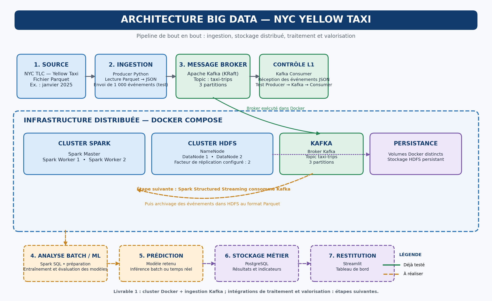

# NYC Taxi – Pipeline Big Data de bout en bout

## 1. Présentation du projet

Ce projet consiste à concevoir et mettre en place un pipeline Big Data de bout en bout à partir des données **NYC TLC Yellow Taxi Trip Records**.

L'objectif est de construire une infrastructure distribuée permettant l'ingestion, le stockage et le traitement des données de trajets de taxis de New York.

## 2. Objectif du Livrable 1

Le premier livrable porte sur la mise en place d'une infrastructure distribuée avec Docker Compose et sur la validation de l'ingestion des événements avec Apache Kafka.

L'infrastructure comprend :

- **Apache Spark :** un Master et deux Workers.
- **HDFS :** un NameNode et deux DataNodes.
- **Apache Kafka :** un broker et le topic `taxi-trips`.
- **Python :** un Producer pour lire les données Parquet et publier les événements JSON dans Kafka.

## 3. Architecture du projet



Le schéma présente l'architecture globale du projet. Il distingue les composants réalisés dans le premier livrable des fonctionnalités prévues dans les étapes suivantes.

## 4. Technologies utilisées

- Docker et Docker Compose
- Apache Spark
- Hadoop HDFS
- Apache Kafka
- Python
- Pandas
- PyArrow
- Git et GitHub

## 5. Fonctionnement de l'ingestion

Le processus d'ingestion réalisé suit les étapes suivantes :

1. Lecture du fichier Parquet NYC Yellow Taxi avec Python.
2. Extraction des informations des trajets.
3. Transformation des enregistrements en événements JSON.
4. Publication des événements dans le topic Kafka `taxi-trips`.
5. Consommation et vérification des événements avec un Kafka Consumer.

## 6. Vérifications réalisées

Les tests suivants ont été effectués :

- Démarrage des conteneurs Docker.
- Vérification du Spark Master et des deux Workers.
- Vérification du NameNode et des deux DataNodes.
- Vérification des volumes persistants.
- Vérification de la réplication HDFS avec un facteur égal à 2.
- Création et description du topic Kafka `taxi-trips`.
- Publication des événements par le Producer Python.
- Réception des événements JSON par le Consumer Kafka.

Le contrôle HDFS a notamment confirmé :
- `Status: HEALTHY`
- `Default replication factor: 2`
- `Average block replication: 2.0`
- `Missing blocks: 0`

## 7. Structure du dépôt

```text
NYC_Taxi_BigData/
├── config/
│   └── docker-compose.yml
├── data/
│   └── .gitkeep
├── producer/
│   └── producer.py
├── scripts/
│   └── hdfs_test.txt
├── docs/
│   ├── architecture.png
│   ├── architecture.md
│   ├── captures/
│   └── documentation/
├── requirements.txt
├── .gitignore
└── README.md
```

Le dataset Parquet n'est pas inclus dans le dépôt GitHub en raison de sa taille. Il doit être téléchargé depuis la source officielle.

## 8. Installation et lancement

### Prérequis

- Docker Desktop
- Docker Compose
- Python
- Git

### Démarrer l'infrastructure

Depuis le répertoire du projet :

```bash
docker compose -f config/docker-compose.yml up -d
```

Vérifier les conteneurs :

```bash
docker compose -f config/docker-compose.yml ps
```

### Installer les dépendances Python

```bash
pip install -r requirements.txt
```

### Lancer le Producer

```bash
python producer/producer.py
```

### Consulter les événements Kafka

```bash
docker exec -it kafka /opt/kafka/bin/kafka-console-consumer.sh --bootstrap-server kafka:9092 --topic taxi-trips --from-beginning
```

## 9. Source des données

Les données utilisées proviennent de la source officielle NYC Taxi and Limousine Commission :

https://www.nyc.gov/site/tlc/about/tlc-trip-record-data.page

## 10. Membres du groupe
EL BAZ HIND,JDANI FATIMA ZAHRA,QASSABA OUMAYMA,BOUHAMIDI MOSTAFA.

## 11. État d'avancement

Le Livrable 1 couvre la mise en place de l'infrastructure Docker, la configuration du cluster Spark et HDFS, ainsi que la validation de l'ingestion des événements avec Kafka.

Les étapes de traitement en streaming, d'analyse et de Machine Learning seront développées dans les livrables suivants.