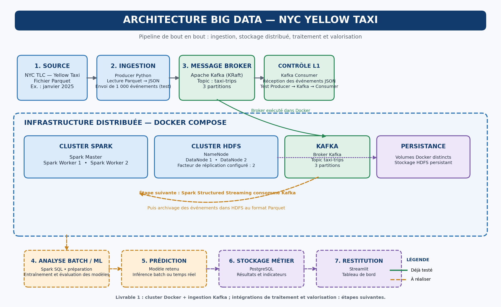
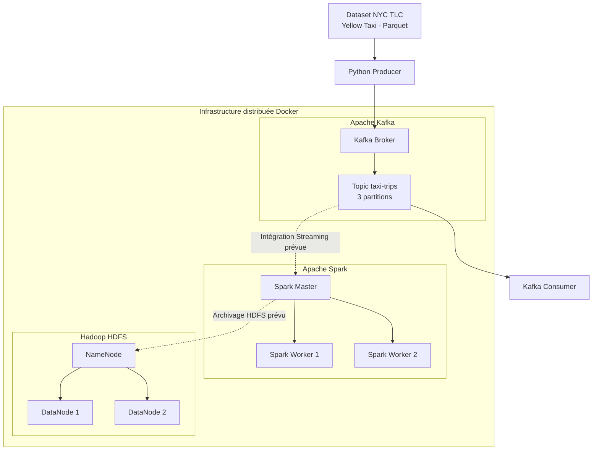

# Architecture du projet NYC Taxi Big Data

# Architecture du projet NYC Taxi Big Data

## 1. Architecture générale

Le projet repose sur une architecture distribuée conteneurisée avec Docker Compose.

## 2. Composants

- **NYC TLC Dataset** : données des trajets Yellow Taxi au format Parquet.
- **Python Producer** : lit les données et les transforme en événements JSON.
- **Kafka Broker** : reçoit les événements.
- **Topic taxi-trips** : topic Kafka organisé en trois partitions.
- **Kafka Consumer** : permet de vérifier la réception des événements.
- **Spark Master** : coordonne l'exécution distribuée.
- **Spark Workers** : exécutent les tâches de calcul.
- **HDFS NameNode** : gère les métadonnées du système de fichiers distribué.
- **HDFS DataNodes** : stockent les blocs de données avec un facteur de réplication de 2.

## 3. État du premier livrable

Les composants Docker, le Producer Python et le test Kafka sont opérationnels.

L'intégration de Spark Structured Streaming avec Kafka et l'archivage automatique dans HDFS seront réalisés dans les étapes suivantes du projet.
